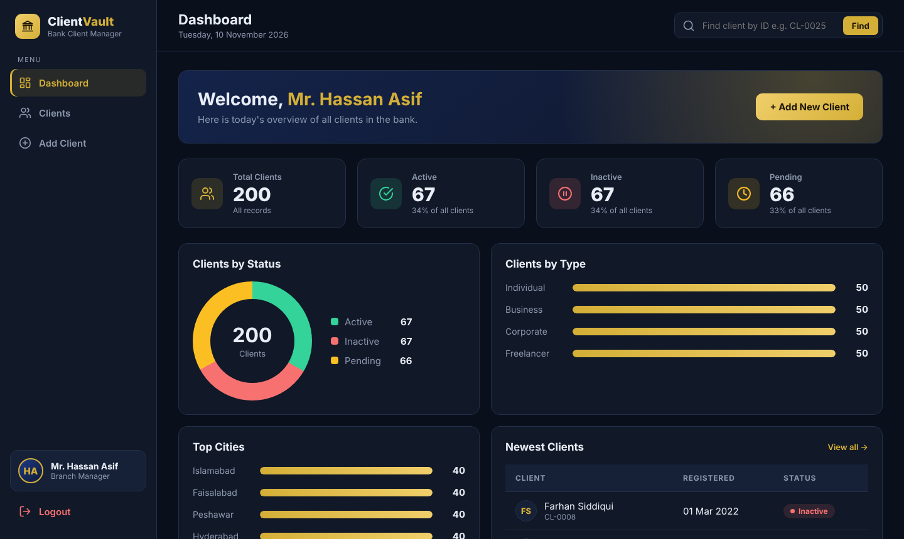
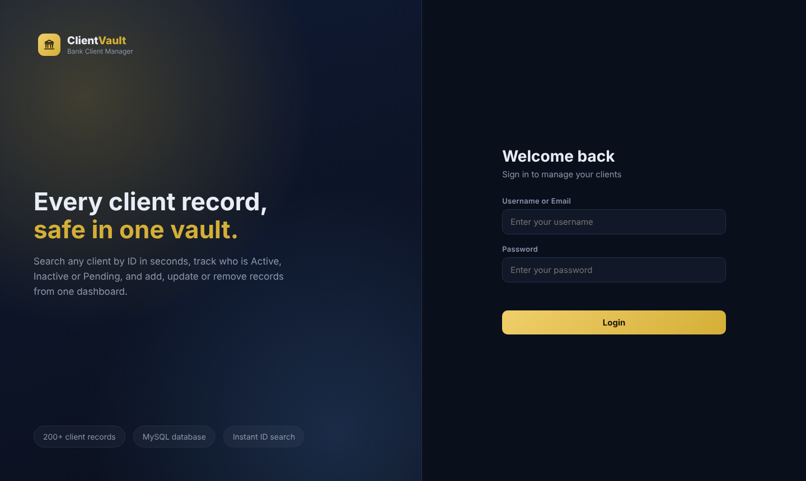
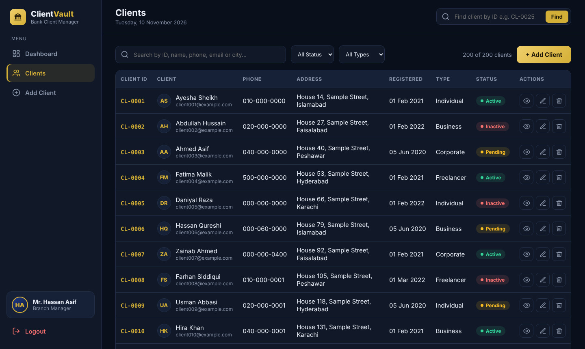
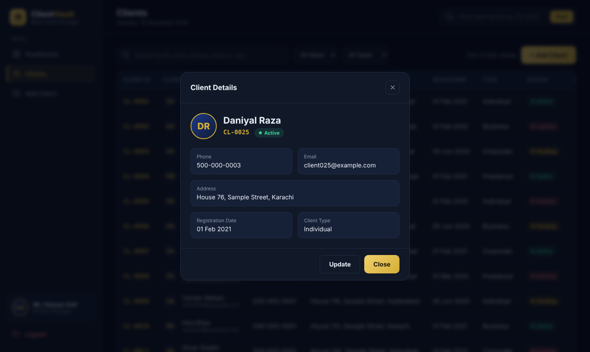
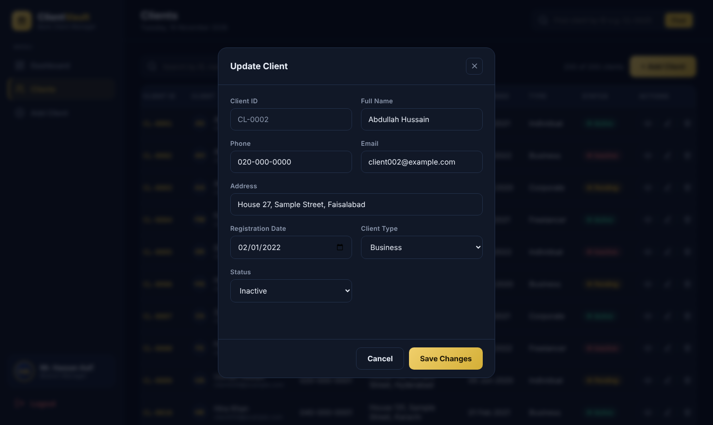
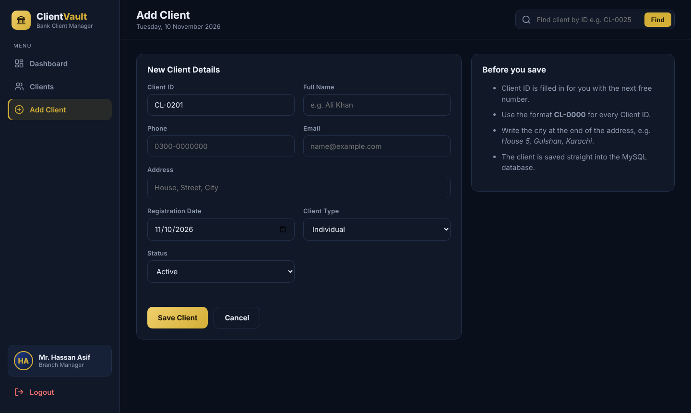

# 🏦 ClientVault – Bank Client Management System

ClientVault is a web-based client management system for a bank branch. It stores **200 client records** in a **MySQL** database and lets the branch manager log in, see a live dashboard, find any client by ID in seconds, and **add, view, update or delete** client records. A **Node.js (Express)** server connects the website to the database. Microsoft **Access** and **Excel** are used for forms, queries and data analysis.

> ICT Project – FAST NUCES, Karachi Campus



---

## ✨ Features

- **Secure login** – inner pages cannot be opened without logging in; logout from the sidebar
- **Live dashboard** – total, Active, Inactive and Pending clients with percentages
- **Charts** – clients by status (donut chart), by type and by city (bar charts), and newest clients
- **Find by Client ID** – type `CL-0025` (or just `25`) to open a client's full details instantly
- **Client list** – search by ID, name, phone, email or city; filter by status and type; page-by-page view
- **Add client** – next free Client ID and today's date are filled in automatically
- **View & update client** – full profile in a pop-up, edit any detail and save
- **Delete client** – with a confirmation pop-up
- **Input validation** – blocks empty fields, wrong email format, wrong ID format and duplicate IDs
- **Microsoft Access** – Clients and Payments tables (one-to-many relationship), forms and an Active Clients query
- **Microsoft Excel** – original client data with validation checks and a PivotTable

---

## 🛠 Tech Stack

| Layer | Technology |
|---|---|
| Frontend | HTML, CSS, JavaScript |
| Backend | Node.js, Express |
| Database | MySQL (XAMPP), phpMyAdmin |
| Data tools | Microsoft Access, Microsoft Excel |
| Version control | Git, GitHub |

---

## ⚙️ How It Works

```
Browser (HTML, CSS, JS)  →  Node.js server (server.js)  →  MySQL database (clientvault)
```

Every button on the website sends a request to the server, and the server runs the matching SQL query:

| Action | Request | SQL |
|---|---|---|
| View all clients | `GET /api/clients` | `SELECT` |
| Find one client | `GET /api/clients/:id` | `SELECT ... WHERE client_id = ?` |
| Add client | `POST /api/clients` | `INSERT` |
| Update client | `PUT /api/clients/:id` | `UPDATE` |
| Delete client | `DELETE /api/clients/:id` | `DELETE` |

---

## 📸 Screenshots

| Login | Clients |
|---|---|
|  |  |

| Client Details | Update Client |
|---|---|
|  |  |

| Add Client |
|---|
|  |

---

## 🚀 How to Run

**Requirements:** [Node.js](https://nodejs.org) and [XAMPP](https://www.apachefriends.org)

1. **Clone the project**
   ```
   git clone https://github.com/hassanasif1659-source/Client-Vault-Management-System.git
   cd Client-Vault-Management-System
   ```
2. **Create the database** – open XAMPP, start **Apache** and **MySQL**, go to `http://localhost/phpmyadmin`, click **Import** and choose `clientvault.sql`.
3. **Install packages**
   ```
   npm install express mysql2
   ```
4. **Start the website** – double-click `START-CLIENTVAULT.bat`, or run:
   ```
   node server.js
   ```
5. Open **http://localhost:3000** and log in with the demo account: `hassan` / `hassan123`

---

## 📁 Project Structure

```
├── index.html, login.js          Login page
├── dashboard.html, dashboard.js  Dashboard with stats and charts
├── clients.html, Clients.js      Client list: search, view, update, delete
├── addclient.html, addclient.js  Add client form
├── app.js                        Shared code: sidebar, login check, pop-ups
├── app.css                       Styles for the whole website
├── server.js                     Node.js + Express backend (REST API)
├── clientvault.sql               Database with 200 sample clients
├── ClientVault.accdb             Microsoft Access database
├── ClientVault.xlsx              Microsoft Excel data and analysis
└── START-CLIENTVAULT.bat         One-click start (Windows)
```

---

## 👤 Author

**Hassan Bin Asif** – 26K-0978
FAST NUCES, Karachi Campus

> All client data in this project is sample data made for demonstration.
